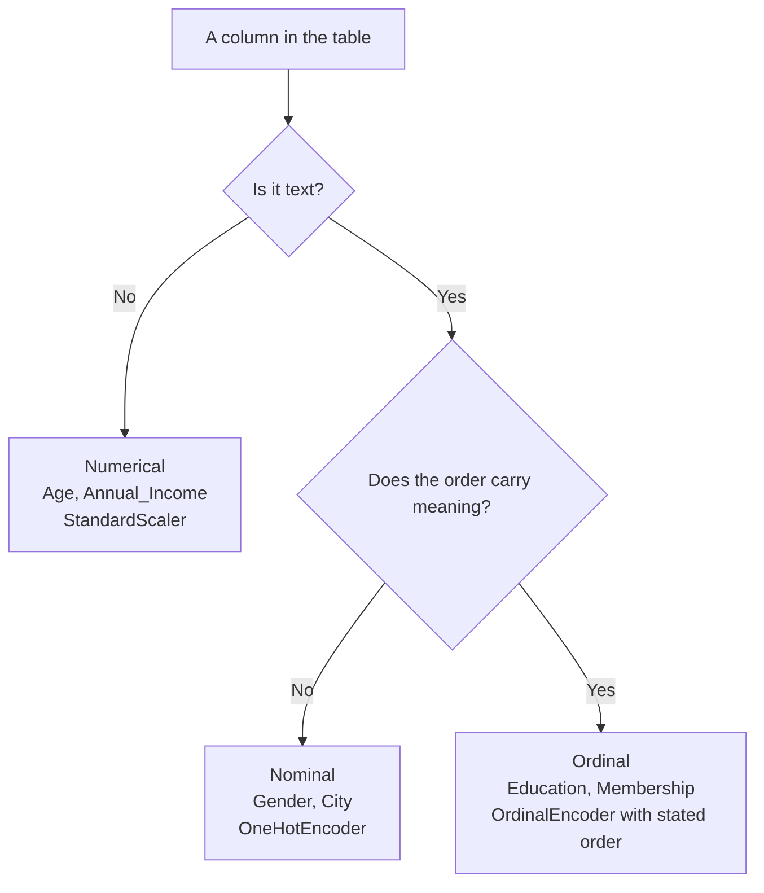
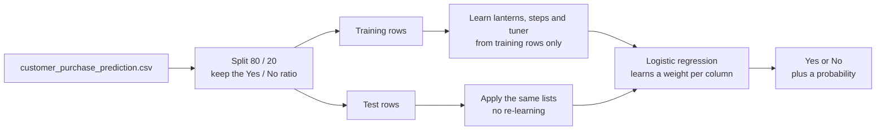

# Binary Universe

https://binary-universe-by-prajwal.streamlit.app/

A project about one question: how do you let a machine learning model understand words?

It takes a small table of customers, converts every text column into numbers without telling the model anything false, trains a logistic regression, and predicts whether a customer will buy. The app that wraps it lives on a black background where 1s and 0s fall in tilted lines, because that is what the model finally sees.

---

## The Night the Model Went Blind

### The lighthouse

At the edge of the data sea there is a lighthouse, and in it lives a keeper called the Model.

The keeper is a brilliant mathematician and completely blind to words. Show her the word "Delhi" and she hears nothing. Her fingertips read only numbers. Every evening, travelers arrive at her door carrying a card:

```
Age   Annual_Income   Gender   City   Education   Membership
```

Each traveler wants one verdict: will I buy from the shop on the hill, yes or no?

The keeper can answer well, but only if every card reaches her as numbers. Someone has to translate. The story is about how that translation can go wrong, and how to do it right.

### The clerk's shortcut

The first translator was a clerk in a hurry. He crossed out the city names and wrote:

```
Delhi = 0      Mumbai = 1      Chandigarh = 2
```

The keeper ran her fingers over the cards and felt a pattern nobody intended.

```
  0 ------------- 1 ------------- 2
Delhi          Mumbai        Chandigarh

  Mumbai sits exactly halfway between the other two.
  Chandigarh is twice as big as Mumbai.
  Delhi is the smallest of all.
```

She began to reason the way mathematicians do. If Chandigarh is twice Mumbai, a Chandigarh traveler must count twice as much as a Mumbai traveler. Her arithmetic was flawless. The lie was in the alphabet she was handed. Cities have no size, no halfway, and no ranking, yet the numbers said they did. A perfect mathematician reading a false number line is confidently wrong.

### The lanterns

Then a data scientist climbed the lighthouse stairs. She did not ask "what number is Delhi?" She asked a better question: "What do I know about these cities, and what do I not know?"

She knew the cities are different. She did not know that any one of them is more than another. So she built a row of lanterns, one for each city, and made a rule: for every traveler, exactly one lantern is lit.

```
                    Chandigarh    Delhi    Mumbai
Delhi traveler          [ ]        [#]      [ ]
Mumbai traveler         [ ]        [ ]      [#]
Chandigarh traveler     [#]        [ ]      [ ]
```

The lit lantern is the "hot" one. That is the whole name: one hot, the rest cold.

Now the keeper felt something different. No city was bigger. The three cities stood at the corners of a perfectly equal triangle, each the same distance from the other two.

```
              Delhi
             (0, 1, 0)
                /\
               /  \
              /    \
             /      \
   Chandigarh ------- Mumbai
    (1, 0, 0)        (0, 0, 1)

   Every pair is the same distance apart: the square root of 2.
```

And each lantern could carry its own weight. The keeper could form one opinion about Delhi travelers and a separate opinion about Mumbai travelers, instead of squeezing every city onto one line. Gender got two lanterns, Female and Male, for the same reason.

### The staircase

The data scientist did not light lanterns everywhere. She walked past two columns and built something else.

Education runs School, Graduate, Postgraduate, PhD. Membership runs Bronze, Silver, Gold, Platinum. These are not neighbors standing in a field. They are steps on a staircase, and climbing a step means something.

```
Education      School -> Graduate -> Postgraduate -> PhD
Step number       0          1            2           3

Membership     Bronze -> Silver -> Gold -> Platinum
Step number       0         1        2         3
```

Here the numbers 0, 1, 2, 3 tell the truth, as long as the order is stated by a human and not guessed alphabetically. Alphabetical order would have put Gold before Silver and Postgraduate before School.

Her rule, which she carved over the door:

> Where no value stands above another, light a lantern.
> Where one value truly stands above another, build a step.

### The stranger

One night a traveler arrived from a city missing from the ledger.

At the lantern row, nothing broke. All the lanterns stayed dark, which meant: this traveler's city tells me nothing. The keeper judged them on everything else. This is the `handle_unknown='ignore'` setting.

The staircase was less forgiving. A membership level that is not on the stairs has no step number, and the encoder refuses. That is why this project checks the data before it trains and names the unknown value instead of failing silently.

### The gong and the whisper

One more problem remained. Annual_Income arrived as a gong, 60000. Age arrived as a whisper, 25. The keeper's hearing was tuned to loud things, so income drowned out age even though loudness says nothing about importance.

The data scientist put both through a tuner so that each has an average of zero and a similar spread. Same volume, fair hearing. That is standardization.

### The rule of the training night

Finally, the data scientist set a discipline. The lantern list, the staircases, and the tuner are learned only from the training night. On the test night, the keeper uses the same lists without updating them. If she peeked at the test travelers while building her lists, her score would be a flattering lie.

### What the story means

One-hot encoding is not a trick for turning words into numbers. It is a promise to the model: I will not tell you anything about these categories that I do not actually know.

Label numbers 0, 1, 2 make a claim that cities have an order. One-hot columns make no claim. They only say who is present.

---

## How a data scientist decides



The one question to ask for every text column: can I honestly say one value is more than another? If not, light a lantern. If so, build a step.

---

## What the project does



### The columns

| Column | Kind | Treatment | What the model receives |
|---|---|---|---|
| Age | Numerical | Standardized | One scaled number |
| Annual_Income | Numerical | Standardized | One scaled number |
| Gender | Nominal | One-hot | Gender_Female, Gender_Male |
| City | Nominal | One-hot | City_Chandigarh, City_Delhi, City_Mumbai |
| Education | Ordinal | Stated order | 0 to 3 |
| Membership | Ordinal | Stated order | 0 to 3 |
| Purchased | Target | Kept as Yes or No | What the model predicts |

### One real customer, before and after

The first row of the data is a 25 year old woman from Delhi with a Graduate degree and a Gold membership, earning 60000. She bought.

```
Before                          After encoding

Gender       Female             Gender_Female       1
                                Gender_Male         0

City         Delhi              City_Chandigarh     0
                                City_Delhi          1
                                City_Mumbai         0

Education    Graduate           Education           1
Membership   Gold               Membership          2

Age          25                 Age                 scaled
Annual_Income 60000             Annual_Income       scaled
```

Seven words and numbers on a card become a row of pure numbers, with no invented ranking among the cities.

### What the model learns

Logistic regression assigns one weight to every column it receives. A positive weight pushes the verdict toward Yes. A negative weight pushes toward No. The probability comes from adding every weight times its value and squeezing the total between 0 and 1.

Because each city has its own lantern, each city gets its own weight. Because Membership is a staircase, it gets one weight that applies per step climbed.

---

## The files

| File | Role in the story |
|---|---|
| `pipeline.py` | The data scientist. Defines which columns get lanterns, steps, or tuning, checks the data, and trains the keeper. |
| `app.py` | The lighthouse itself. Three rooms: Encode shows the cards before and after translation, Train lets the keeper learn, Predict judges a new traveler and shows the exact numbers she received. |
| `rain.js` | The night sky. Tilted rain of 1s and 0s and a field of stars drawn behind the page. |
| `styles.css` | Makes the page black and lets the sky show through. |
| `customer_purchase_notebook.ipynb` | The same journey told step by step in a notebook, one stage per cell. |
| `dataset/customer_purchase_prediction.csv` | The travelers: 30 customers with their cards and their verdicts. |
| `training_lg.py`, `one_hot_encoding_example.py`, `ordinal_encoding_example.py` | The original lessons this project grew from. One shows lanterns alone, one shows the staircase alone, one joins them with a model. |

### What changed from the original lesson

The original script already had the central idea right: lanterns for nominal columns, a stated staircase for ordinal ones, and encoders learned from training rows only. This project adds three things.

1. Numerical columns are standardized, so the gong of income does not drown the whisper of age.
2. Encoding and model live in one pipeline, so a new traveler goes through exactly the same translation as the training travelers.
3. The model is measured with accuracy, a confusion matrix, and its learned weights, so the verdict can be examined and not just printed.

---

## Honest limits

- The dataset has 30 rows, so the test set has about 6. An accuracy of 100 percent or 67 percent on six rows says very little. This is a teaching dataset.
- One-hot encoding adds one column per category. With three cities that is cheap. With ten thousand cities it would explode the table, and other methods become necessary.
- The three city lanterns always add up to one, so one of them is technically redundant. Logistic regression handles this comfortably, but it is worth knowing.
- Gender, City, and the other columns describe correlation in this small sample, not cause. A model that finds a pattern has not found a reason.

---

## Summary

A model reads numbers. Text must be translated, and a careless translation invents facts: that Chandigarh is twice Mumbai, that Gold comes before Silver, that income matters because it is large. This project translates each column according to what is actually true about it, then lets a logistic regression learn from numbers that do not lie.
